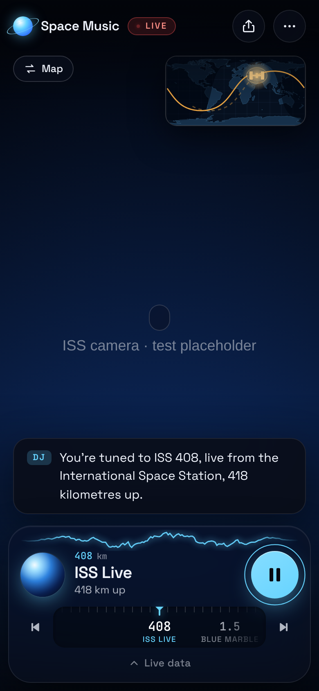
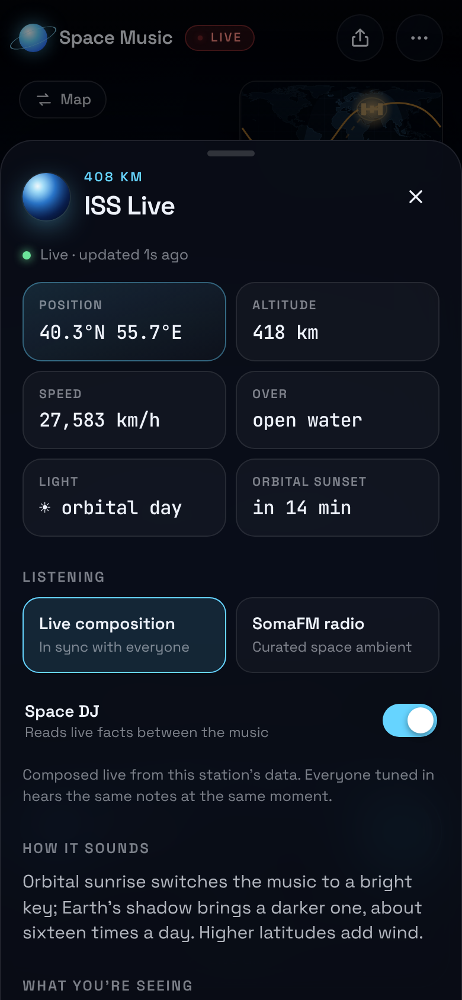
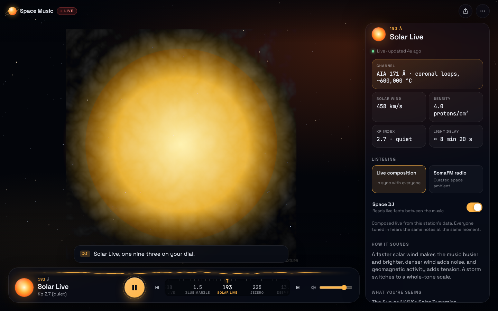

# Space Music

**Live radio from the solar system.** Six stations of live space views (the ISS, the whole Earth, the Sun, Mars, the deep sky and the next rocket launch), with music composed live from each station's data. **Everyone on a station hears the same music at the same moment**, so you can send someone a link, or put it on YouTube or TikTok, and listen together.

| Phone | Live data | Desktop |
| --- | --- | --- |
|  |  |  |

| Going live (16:9) | Vertical stream | Car mode |
| --- | --- | --- |
|  |  |  |

> The screenshots were rendered by the smoke test with **fixture data and synthetic stand-in images** (marked "TEST IMAGE"), because the build sandbox had no internet access. Real use shows NASA's live imagery.

The thinking behind it (direction, music licensing, listening together, the TV and car paths, and open decisions) is in **[docs/CONCEPT.md](docs/CONCEPT.md)**. How to stream it is in **[docs/BROADCAST.md](docs/BROADCAST.md)**.

## Stations

| # | Dial | Station | You see | The music follows |
| --- | --- | --- | --- | --- |
| 1 | 408 | **ISS Live** | NASA's live ISS camera, plus a map with the ground track and day/night line | Orbital sunrise and sunset (the key changes), latitude |
| 2 | 1.5 | **Blue Marble** | The whole sunlit Earth from NASA EPIC at L1 | Earth's rotation (chords follow longitude) |
| 3 | 193 | **Solar Live** | The Sun in six SDO wavelengths | Solar wind speed and density, Kp index (storms change the scale) |
| 4 | 225 | **Jezero** | Perseverance's latest raw images | Local time on Mars; dusty afternoon winds |
| 5 | 13.8 | **Deep Field** | Astronomy Picture of the Day and the days before it | Today's date (a new piece every day) |
| 6 | T-0 | **Launch Pad** | Countdown to the next launch on Earth | Gets busier over the last 48 hours |

## Listening together

- **In sync without a server.** Chords and notes sit on a grid counted from the Unix epoch, and every random choice is seeded by station and time slot, so a friend who opens your link joins mid-chord on the same note. Slideshows are locked to the clock too.
- **Share** from the top bar (share sheet on phones, copied link elsewhere), or show a **QR code** for people nearby. Links look like `…/#sun` and open straight on that station.
- **Go live** on YouTube, Twitch, TikTok or Instagram with `?broadcast`: an on-air layout with a "tune in on your phone" QR code. See [docs/BROADCAST.md](docs/BROADCAST.md).

## Run it

No build step and no runtime dependencies. It's plain HTML and ES modules, served over HTTP:

```sh
python3 -m http.server 8080     # or: npx serve .
# open http://localhost:8080 and press "Tune in"
```

To host it, any static host works, including GitHub Pages (*Settings → Pages → Deploy from a branch*). On phones it installs as an app, with home-screen shortcuts to each station. When you deploy, set the `og:image` meta tag in `index.html` to an absolute URL so link previews show the card everywhere.

**Optional:** get a free NASA API key at [api.nasa.gov](https://api.nasa.gov) and paste it in ⋯ → Settings. The shared `DEMO_KEY` allows about 30 requests an hour.

### Controls

Swipe the picture or drag the tuning ruler to change station, tap the station art for live data, and use ⋯ for TV mode, car mode, the join code, going live and settings. Lock-screen, headset and steering-wheel next/previous buttons change station.

| Key | Action |
| --- | --- |
| `Space` | Play / pause |
| `1`–`6`, `←` `→` | Change station |
| `I` | Live data |
| `S` | Share |
| `M` | Music source: live composition ↔ SomaFM |
| `D` | Space DJ on/off |
| `T` | TV mode (full screen, controls fade away) |
| `C` | Car mode (big buttons, nothing moving; `Esc` exits) |

## How it works

```
sources.js   live data: wheretheiss.at, NASA EPIC / SDO / APOD / Perseverance raw images,
             NOAA SWPC, Launch Library 2 (each with fallbacks, cached where rate-limited)
astro.js     computed locally: Sun position, ISS orbit and Earth's shadow, Mars time
             (Mars24 algorithm), Earth–Mars distance (JPL elements)
stations.js  each station: its mood (key, scale, tempo, timbre), how its data shapes the
             music, its live facts, and what the DJ says
engine.js    the live composition: pads, sub bass, plucked "stars", wind, telemetry blips,
             reverb and tuning static (Web Audio, no samples), scheduled on a shared clock
radio.js     SomaFM streams as an alternative music source
dj.js        Space DJ: speech synthesis, ducking, sentence-by-sentence subtitles
views.js     clock-synced slideshow, ISS camera + map, launch countdown, starfield, oscilloscope
map.js       world map: Natural Earth coastlines, terminator, ground track, footprint
app.js       the interface: tuning, swipe, sheet, sharing and QR, TV/car/broadcast modes
```

When a source is unreachable the station says **no signal** and retries; it never shows made-up data. The ISS map, the Mars clock and the Earth–Mars distance are computed locally, so they keep working offline.

## Tests

```sh
npm test         # unit tests: astronomy, parsers, and the in-sync composition (Node 20+)
npm run smoke    # browser test with Playwright; screenshots go to test/screenshots/
node tools/render-art.mjs   # re-render art/*.png (lock-screen artwork) and og.png
```

The smoke test answers every API with fixtures shaped like that API's documented responses (including both of NOAA's JSON formats). It then drives all six stations, two listeners joining a few seconds apart (checking they hear the same chord), swiping, the tuner, sharing and QR, settings, TV and car modes, a phone viewport, and both broadcast layouts.

## Status

This is a **prototype**. The live endpoints couldn't be reached from the environment it was built in, so the first run against the real APIs may turn up endpoint changes. Check the browser console for `[station]` warnings. Known limits:

- NASA's YouTube live stream ID changes over time. The default embeds NASA's channel live stream; paste a specific ISS stream in Settings if that shows a different broadcast.
- SomaFM's audio can't be measured cross-origin, so the oscilloscope only draws the live composition.
- Background playback with the screen locked depends on the browser.

## Credits

Data and imagery: NASA (EPIC/DSCOVR, SDO, APOD, Perseverance raw images, NASA/JPL-Caltech), NOAA Space Weather Prediction Center, [wheretheiss.at](https://wheretheiss.at), [The Space Devs](https://thespacedevs.com) Launch Library 2. APOD images are often copyrighted by their photographers, and the app shows each credit. Radio: [SomaFM](https://somafm.com) (listener-supported). Map: Natural Earth (public domain). Fonts: Space Grotesk and JetBrains Mono (SIL Open Font License, in `fonts/`). QR codes: qrcode-generator by Kazuhiko Arase (MIT, in `vendor/`).
