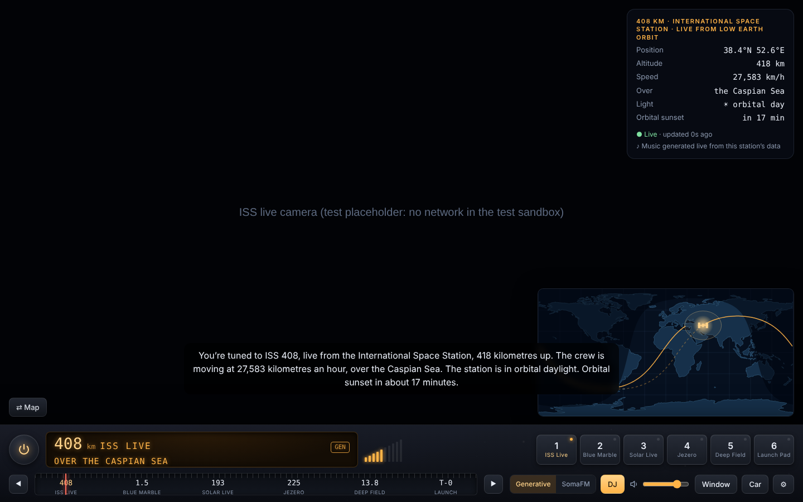
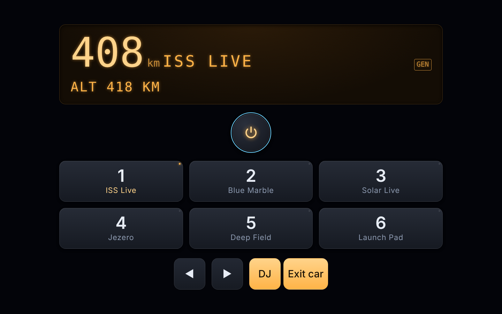
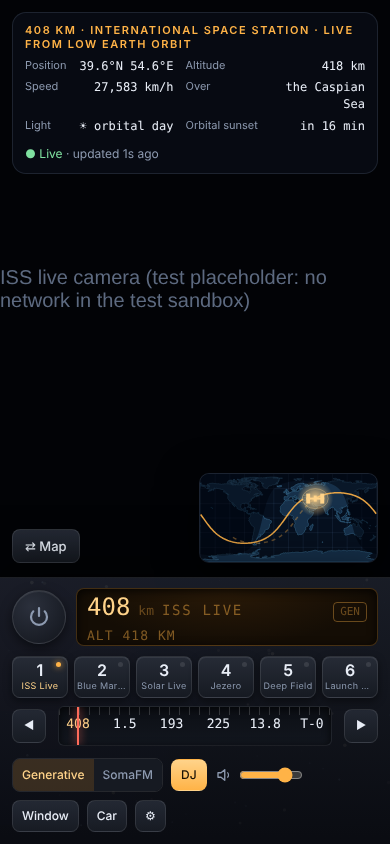

# Space Music

**A radio for the solar system.** Six stations of live space views (the ISS, the whole Earth, the Sun, Mars, the deep sky and the next rocket launch), with music generated live from each station's data, a Space DJ reading what's happening, and a car mode.



| Car mode | Phone |
| --- | --- |
|  |  |

> Screenshots were rendered by the smoke test with **fixture data** (the build sandbox had no internet access). Real use shows NASA's live imagery.

The thinking behind it, covering form factors, music licensing, how this reaches a car or a TV, and the open decisions, is in **[docs/CONCEPT.md](docs/CONCEPT.md)**.

## Stations

| Preset | Dial | Station | You see | The music follows |
| --- | --- | --- | --- | --- |
| 1 | 408 | **ISS Live** | NASA's live ISS camera, plus a map with the ground track and day/night line | Orbital sunrise and sunset (the key changes), latitude |
| 2 | 1.5 | **Blue Marble** | The whole sunlit Earth from NASA EPIC at L1 | Earth's rotation (chords follow longitude) |
| 3 | 193 | **Solar Live** | The Sun in six SDO wavelengths | Solar wind speed and density, Kp index (storms change the scale) |
| 4 | 225 | **Jezero** | Perseverance's latest raw images | Local time on Mars; dusty afternoon winds |
| 5 | 13.8 | **Deep Field** | Astronomy Picture of the Day and its archive | Today's date (a new piece every day) |
| 6 | T-0 | **Launch Pad** | Countdown to the next launch on Earth | Builds up over the last 48 hours |

## Run it

No build step and no dependencies. It's plain HTML and ES modules, so it needs to be served over HTTP:

```sh
python3 -m http.server 8080     # or: npx serve .
# open http://localhost:8080 and press the ⏻ button
```

To host it, any static host works, including GitHub Pages (*Settings → Pages → Deploy from a branch*). It installs as an app (PWA) on phones.

**Optional:** get a free NASA API key at [api.nasa.gov](https://api.nasa.gov) and paste it in ⚙ Settings. The shared `DEMO_KEY` allows about 30 requests an hour.

### Controls

| Key | Action |
| --- | --- |
| `Space` | Power on/off |
| `1`–`6` | Presets (press again to hear the DJ's intro) |
| `←` `→` | Tune; you can also drag or scroll the dial |
| `M` | Music source: Generative ↔ SomaFM |
| `D` | Space DJ on/off |
| `W` | Window mode (full screen, controls fade away) |
| `C` | Car mode (giant buttons, nothing moving; `Esc` exits) |

Headset and steering-wheel **next/previous** buttons change station (Media Session API).

## How it works

```
sources.js   live data: wheretheiss.at, NASA EPIC / SDO / APOD / Perseverance raw images,
             NOAA SWPC, Launch Library 2 (each with fallbacks, cached where rate-limited)
astro.js     computed locally: Sun position, ISS orbit propagation and Earth-shadow,
             Mars time (Mars24 algorithm), Earth–Mars distance (JPL elements)
stations.js  each station: its mood (key, scale, tempo, timbre), how its data maps to the
             music, telemetry, and what the DJ says
engine.js    generative music: pads, sub bass, plucked "stars", wind, telemetry blips,
             reverb, radio static between stations (Web Audio, no samples)
radio.js     SomaFM streams as an alternative music source
dj.js        Space DJ: speech synthesis, ducking, captions
views.js     slideshow, ISS camera + map, launch countdown, starfield
map.js       world map: Natural Earth coastlines, terminator, ground track, footprint
app.js       the radio: tuning, presets, dial, modes, Media Session, settings
```

When a source is unreachable the station says **no signal** and retries; it never shows made-up data. The ISS map, Mars clock and Earth–Mars distance are computed locally, so they keep working offline.

## Tests

```sh
npm test         # unit tests: astronomy math, parsers, formatting (Node 20+)
npm run smoke    # browser smoke test with Playwright; screenshots go to test/screenshots/
```

The smoke test answers every API with fixtures shaped like that API's documented responses (including both of NOAA's JSON formats), then drives all six stations, the audio engine, the SomaFM fallback, car mode and a phone viewport.

## Status

This is a **prototype**. The live endpoints couldn't be reached from the environment it was built in, so the first run against the real APIs may turn up endpoint changes. Check the browser console for `[station]` warnings. Known limits:

- NASA's YouTube live stream ID changes over time. The default embeds NASA's channel live stream; paste a specific ISS stream in Settings if that shows a different broadcast.
- SomaFM's audio can't be measured cross-origin, so the VU meter only moves in Generative mode.
- Background playback with the screen locked depends on the browser. Native apps (see the concept doc) solve this properly.

## Credits

Data and imagery: NASA (EPIC/DSCOVR, SDO, APOD, Perseverance raw images, NASA/JPL-Caltech), NOAA Space Weather Prediction Center, [wheretheiss.at](https://wheretheiss.at), [The Space Devs](https://thespacedevs.com) Launch Library 2. APOD images are often copyrighted by their photographers, and the app shows each credit. Radio: [SomaFM](https://somafm.com) (listener-supported). Map: Natural Earth (public domain).
