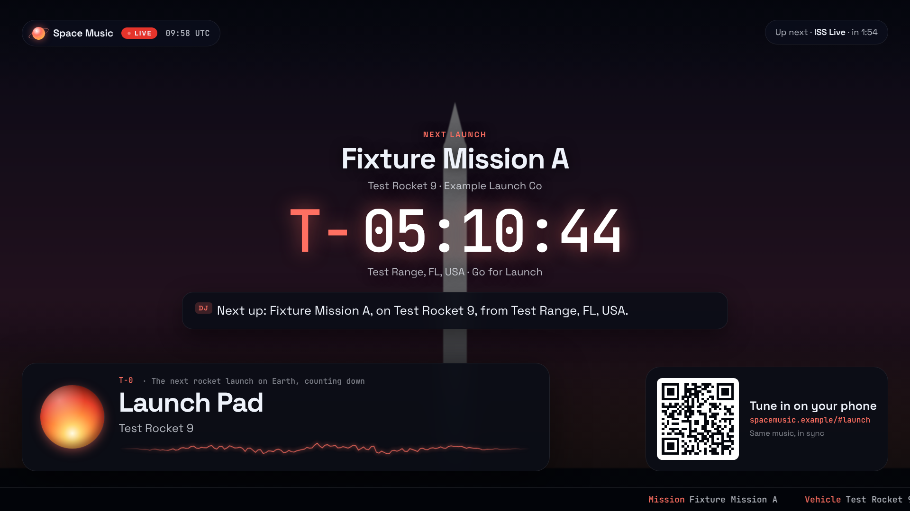
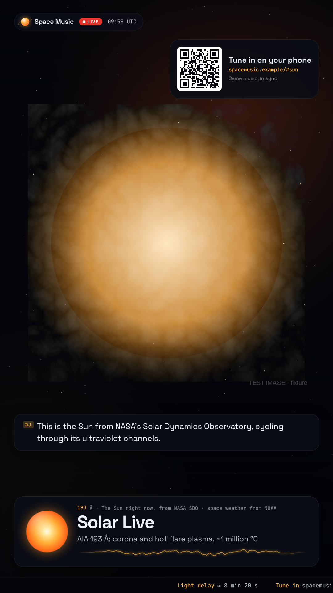

# Going live: YouTube, Twitch, TikTok, Instagram

Space Music has an on-air layout made for live streams. It has a "Live" bug with a UTC clock, a lower third with the station and its live facts, a scrolling telemetry ticker, an "Up next" countdown, and a **QR code that viewers scan to tune in on their phones**.



## The URL

Add `?broadcast` to the app's address:

```
https://YOUR-HOST/?broadcast
```

| Option | Example | What it does |
| --- | --- | --- |
| `rotate` | `rotate=10` | Minutes per station (default 10). The schedule follows the UTC clock, so every stream and viewer agrees on what's on. `rotate=0` stays put. |
| `stations` | `stations=iss,earth,sun` | Which stations to rotate through, in order. Ids: `iss`, `earth`, `sun`, `mars`, `deep`, `launch`. |
| `#station` | `?broadcast#sun` | Start on (or, without `rotate`, stay on) one station. |
| `join` | `join=https://spacemusic.example/` | The address the QR code and ticker point viewers to. Set this when you run the broadcast page somewhere other than your public site (e.g. on `localhost`). |
| `camera` | `camera=0` | ISS Live shows the map instead of embedding NASA's YouTube camera. Use this to avoid re-streaming YouTube content inside a YouTube stream. |
| `dj` | `dj=0` | Turn off the Space DJ's spoken intros and captions. |

The layout adapts to the canvas: **1920×1080** for YouTube and Twitch, **1080×1920** for TikTok, YouTube Shorts and Instagram Live.



## Streaming it with OBS (free)

1. **Host the app** somewhere public, such as GitHub Pages (*Settings → Pages → Deploy from a branch*). The QR code needs a public address so viewers can join.
2. In **OBS → Sources → + → Browser**:
   - URL: `https://YOUR-HOST/?broadcast&rotate=10`
   - Width/Height: `1920` × `1080` (or `1080` × `1920` for vertical; also set *Settings → Video* to match)
   - Tick **Control audio via OBS**, so the music goes into the stream.
3. Check the audio meter in OBS's mixer. If the page shows "Click to start the broadcast audio", right-click the source and choose **Interact** to click it once.
4. **YouTube:** in YouTube Studio choose *Create → Go live → Stream*, copy the stream key into *OBS → Settings → Stream* (service: YouTube), then press *Start Streaming*. Twitch, TikTok Live and Instagram Live work the same way with their own stream keys or RTMP URLs (TikTok and Instagram require eligible accounts).

**The DJ's voice** comes from the computer's text-to-speech, not the page. A browser source carries the captions but not the voice. If you want the voice on stream, add a *Desktop Audio* source, or leave the DJ to captions only.

**24/7 streams** need an always-on machine running OBS (a small cloud VM works). A future server-side renderer could make this unattended; see [CONCEPT.md](CONCEPT.md).

## How "joining" works, and its limits

The music is composed from a shared clock and the same live data for everyone (see `js/engine.js`). A phone that scans the QR code therefore plays **the same notes as every other listener in the app**, without a server.

The stream itself is delayed by the platform's latency: a few seconds in YouTube's ultra-low-latency mode, and longer otherwise. So a viewer listening on their phone while watching the stream will hear the phone *ahead* of the video by that delay. People listening in the app are in sync with each other.

## Rights checklist before you go live

- **Music:** broadcast mode always uses the live composition, which this project generates itself. It never rebroadcasts SomaFM; that needs SomaFM's permission.
- **NASA imagery** (EPIC, SDO, Perseverance raw images) is generally free to use. Don't use NASA logos in a way that implies endorsement.
- **Astronomy Picture of the Day** images are often **copyrighted by their photographers**. For monetized streams, check rights or leave Deep Field out (`stations=iss,earth,sun,mars,launch`).
- **NASA's YouTube ISS camera:** the footage is NASA's, but embedding a YouTube player inside a YouTube stream can trip automated claims. Use `camera=0` to show the live map instead.
